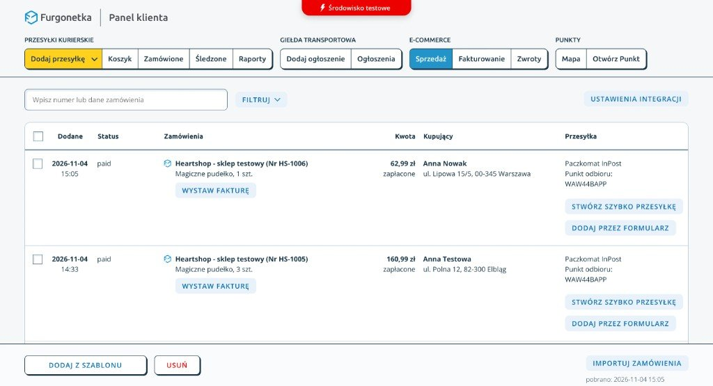

# Heartshop Goods

A small, self-hosted shop for physical products, by [Heartmade Studio](https://heartmade.pl/). Plain HTML/CSS/JavaScript, PHP and SQLite.

**Built for real transactions with PAYMOVE.io and Furgonetka.pl.** PAYMOVE is the intentionally chosen agent-oriented payment gateway; Heartshop currently connects through its server-side REST API, browser checkout and signed webhooks. Heartshop exports paid physical orders and invoice data into the Furgonetka client panel. That panel is where the merchant processes orders — shipments and labels — and issues sales invoices. Heartshop does not issue invoices itself or include an autonomous payment agent.



*Furgonetka client panel, test environment, captured 2026-11-04. Orders from the Heartshop test shop arrive under E-commerce → Sales. The merchant creates the shipment here and issues the invoice from the same list.*

This initial standalone distribution starts in **local simulation**. Live selling requires your merchant accounts, real product/seller/legal content, configuration and the acceptance checks in [production setup](docs/production.md). Automated tests do not establish that a merchant account is ready to take money.

## Prosty sklep, który możesz prowadzić po swojemu

Masz jeden produkt i chcesz sprzedawać go z własnej strony? Heartshop Goods
łączy płatność PAYMOVE.io z panelem klienta Furgonetka.pl. Opłacone zamówienia
pojawiają się w tym panelu: tam sprzedawca obsługuje przesyłki i wystawia faktury.
Sam sklep faktury nie tworzy. To prosty punkt wyjścia, bez koszyka wielu produktów
i magazynu.

To projekt open source Heartmade Studio na licencji MIT. Możesz pobrać kod,
uruchomić przykład lokalnie i dostosować go do swojej działalności. Programistom
daje niewielki kod PHP/SQLite, testy i opis integracji. Pierwsze uruchomienie jest
symulacją; przed sprzedażą trzeba przygotować dane sprzedawcy, regulamin, hosting
i sprawdzić płatności na swoim koncie. Nie ma tu obietnicy gotowego wdrożenia po
samym sklonowaniu repozytorium.

### Wolisz, żebyśmy skonfigurowali sklep dla Ciebie?

[Zobacz strony i sklepy przygotowywane przez Heartmade](https://heartmade.pl/websites).
Pomagamy ogarnąć technologię, żeby zostało Ci więcej miejsca na własną pracę.
Zakres i warunki wdrożenia ustalane są dla konkretnego sklepu. Bezpłatny kod nie
obejmuje hostingu ani opieki nad uruchomionym sklepem.

### Zobacz przykład

Demo na żywo: [heartmade.pl/heartshop](https://heartmade.pl/heartshop/) (osobna instalacja Heartmade, płatności testowe).


[Zobacz również odpowiedź o fakturach](docs/screenshots/invoice-faq.jpg).

Zrzut z lokalnej symulacji, z syntetyczną ofertą. Ilustracja AI nie przedstawia
rzeczywistego produktu ani gabinetu sprzedawcy. To nie jest zrzut sklepu klienta.

## Run locally

Requirements: **PHP 8.2–8.5** with `curl`, `sqlite3` and `mbstring`. PHP 8.2 is the tested minimum; prefer 8.5 for new installations. macOS and Linux are supported; on Windows use WSL. No Composer, npm install or database server is required.

```sh
git clone https://github.com/heartmade-studio/Heartshop-Goods.git
cd Heartshop-Goods
php scripts/dev/start.php
```

Open **http://localhost:8080/heartshop/**. Use `localhost`, not the numeric IP, because the origin is checked. To change the port: `php scripts/dev/start.php 8081`.

- Physical product: `/heartshop/` (PL and EN).
- Orders panel: `/heartshop/panel/`; local-only password: `local-heartshop-only`.
- Place an order using made-up details and courier delivery. The **local simulation** dialog lets you complete or cancel it.
- No real payment, email or shipment is made. Paczkomat lookup is disabled in local simulation to avoid provider calls. Demo orders are excluded from Furgonetka export.
- Ctrl-C stops the server. Local data persists in ignored `var/local/`; deleting that directory resets synthetic orders. The launcher regenerates only its dedicated local configuration, never your merchant `.env`.

The local simulator is not PAYMOVE sandbox. It checks the application flow without credentials; provider acceptance uses the real sandbox on an HTTPS staging host.

## What is included

- Server-priced PLN checkout, physical product example.
- PAYMOVE hosted checkout, HMAC-verified webhooks, immutable order snapshots and retry protection.
- Furgonetka authenticated order export and tracking-number callback.
- Seller panel: orders, notes, CSV, and manual markers for invoice and fulfillment status. Issuing the invoice stays in the Furgonetka panel.
- Durable email outbox with a separate CLI worker.
- Polish and English storefront; the panel is currently Polish.

No inventory reservation, variant selector, combined multi-product cart, automatic refunds or automatic reconciliation of payments held for `review`. Lost create responses are recovered under the same `externalId` (see [docs/integrations.md](docs/integrations.md#payment-recovery)). Voucher sales are in the separate [Heartshop Vouchers](https://github.com/heartmade-studio/Heartshop-Vouchers) repository. PAYMOVE account fees and Furgonetka services are separate from this code.

## Deploy for real transactions

Follow [production setup](docs/production.md) and [integration contracts](docs/integrations.md). Only `public/` is the web root. `private/`, `scripts/`, `tests/` and the rest of the repository must stay outside it. Apache 2.4 with direct HTTPS is the documented runtime; a PHP development server is never a production deployment.

The storefront is an editable sample. Pricing and offers live in `public/heartshop/api/config.php`; seller and product copy lives in the HTML. Do not enable production payments until both describe your actual offer. The supplied offer has `demo: true`, and `production_ready` is false by default.

## Verify changes

Additional test requirements: Node.js 22+, Python 3, Apache 2.4 and OpenSSL.

```sh
bash scripts/heartshop/check.sh
```

Tests run with synthetic credentials and isolated temporary databases. They cover backend behavior, the frontend, real HTTP endpoints, Apache HTTPS boundaries, production-mode configuration and the local simulation. GitHub Actions runs the same suite; there is no deployment workflow.

## Documentation and license

- [Merchant indexing and metadata](docs/indexing.md)
- [Hosting options](docs/hosting.md)
- [Edition isolation follow-up](docs/edition-isolation.md)
- [v0.1.0 release notes](docs/releases/v0.1.0.md)
- [Architecture and extraction boundaries](docs/architecture.md)
- [Production setup](docs/production.md)
- [PAYMOVE and Furgonetka contracts](docs/integrations.md)
- [Security reporting](SECURITY.md)
- [MIT license](LICENSE), with separate [third-party notices](THIRD_PARTY_NOTICES.md).

The included product images are labeled AI illustrations, not photographs of goods or services for sale. Heartmade Studio provides project authorship and implementation services; operating a deployed shop remains the merchant's responsibility.

Want it set up for you instead? Heartmade configures Heartshop stores, content and legal templates as a paid service: see [Heartmade websites and stores](https://heartmade.pl/en/websites).
